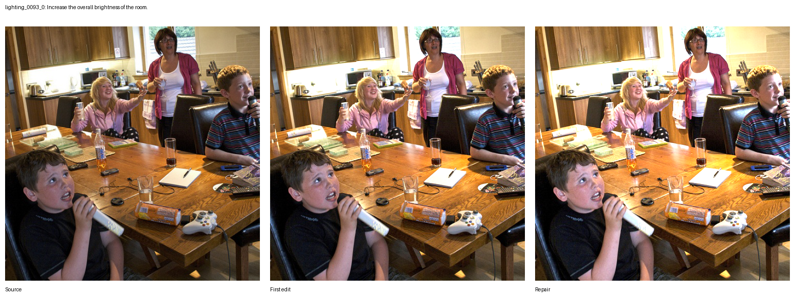
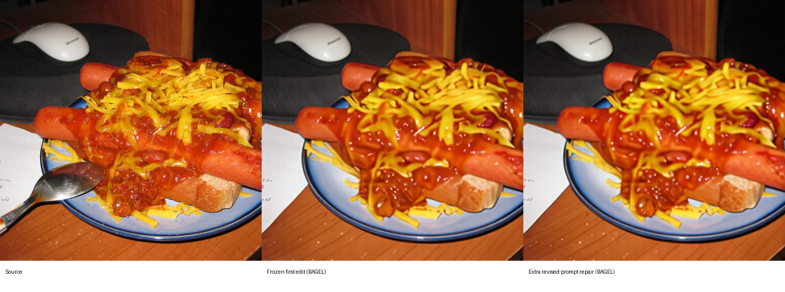

# EditAgentLite Midterm Pilot: Experiment and Results Report

**Team:** Akshat Singhal, Ashvin Sehgal, Shubhangi Katariyar  
**Project:** EditAgentLite — a budget-aware, feedback-driven image-editing agent  
**Report status:** Automated pilot complete; independent human ratings have not been collected.

## 1. Executive summary

This pilot tests a small part of our proposed workflow: make an initial image edit, ask a vision-language model (VLM) to inspect it, classify a possible failure, and selectively make one repair. We used eight real-image, single-instruction tasks from Complex-Edit: four object removals and four global-brightness edits. BAGEL handled removal; a deterministic Pillow brightness operation handled lighting; Qwen3-VL-4B-Thinking reviewed all eight results. After that frozen run, we also ran one clearly separated BAGEL spoon-removal repair as an extra, out-of-protocol check.

All eight first edits completed, all eight received a Qwen response, and the first two executable failures in manifest order received a repair. Qwen marked all four removal outputs `pass` and all four brightness outputs `incomplete_edit`. The two selected brightness repairs ran using a brightness factor of 1.5. These are **automated checks and execution outcomes**, not human quality scores. Because the rating forms are still blank, the project cannot yet report first-edit success, Qwen false-acceptance rate, or whether the repairs improved image quality.

The pilot demonstrates that the models and tool can be connected in a small sequential workflow on one L4 GPU. It does not establish that feedback improves editing, that Qwen's judgments are correct, or that EditAgentLite outperforms EditAgent or another baseline.

## 2. Research question and motivation

The course project asks whether a small VLM can make a low-cost image-editing pipeline more useful by inspecting an editor's output, labeling a failure, and selecting a targeted tool or editor repair. The midterm pilot emphasizes basic feasibility and records the work needed to measure quality later.

The proposal was broader. For this milestone, we limited the work to image editing, two task types, eight examples, Qwen3-VL-4B-Thinking, BAGEL, a deterministic brightness tool, and at most two repairs. The feedback loop is motivated by agentic image-editing work, including EditAgent. Our pilot is a small, budget-aware course study; it is not a reproduction or direct benchmark comparison with EditAgent.

## 3. Benchmark and frozen protocol

### Dataset and sample

We used the real-image portion (`test_real`) of the public [Complex-Edit dataset](https://huggingface.co/datasets/UCSC-VLAA/Complex-Edit), which was designed to evaluate instruction-based image editing across task and instruction complexity. The frozen sample contains eight atomic instructions: four `Remove an Object` tasks and four global-brightness tasks. It uses dataset image IDs 0088, 0095, 0204, 0607, 0093, 0309, 0627, and 0675, selected into the manifest with seed 2026. Three removal candidates were excluded before generation because the requested object was absent or ambiguous.

This is a **small pilot subset**, not a full Complex-Edit benchmark run. We do not compute the dataset's official aggregate metric or claim results representative of the dataset. We score no reference target images; the plan uses source image, request fulfillment, preservation, and usability for human assessment.

### Frozen first-edit and feedback procedure

1. Run one first edit per manifest task in order. BAGEL-7B-MoT NF4 with 30 denoising timesteps handles removal requests. Pillow applies brightness 1.25 and contrast 1.0 for global-lighting requests.
2. Freeze the first outputs. Each source is 500×500; BAGEL outputs are 512×512, while the Pillow operation retains source dimensions.
3. Give each completed first result and its instruction to Qwen3-VL-4B-Thinking. Save its raw answer and structured label (`pass` or a failure label).
4. In manifest order, repair at most the first two flagged tasks for which Qwen supplies a supported action. The repair starts from the original source, and both first and repaired candidates are retained.
5. Prepare blind image cards and two empty rater forms. Human evaluation is not included in the automated run.

The frozen manifest, selection/exclusion log, hashes, run records, raw Qwen outputs, and rating packet are under [`outputs/pilot_artifacts/`](outputs/pilot_artifacts/). The exact task instructions are in [`pilot/manifest.csv`](pilot/manifest.csv).

## 4. Systems and compute environment

| Component | Configuration used |
| --- | --- |
| GPU host | GCP Spot VM `g2-standard-8`, one NVIDIA L4 (23 GB advertised GPU memory), `us-east1-c` |
| Editing model | BAGEL-7B-MoT checkpoint `5019f57d168e5816e8f3f701b17cc816bb7cf24b`, NF4; 30 timesteps; seed 2026 |
| Review model | Qwen3-VL-4B-Thinking checkpoint `1de27d8c51f12e819435303b9e84c4e25ba8401e`, bfloat16; seed 2026 |
| Cheap lighting editor | Pillow brightness 1.25, contrast 1.0 for first edits; Qwen-selected brightness factor 1.5 for the two repairs |
| Removal tool smoke test | OpenCV Telea inpainting, radius 3, with human-drawn polygon masks |

The model and implementation identifiers are recorded in [`PILOT_HANDOFF.md`](PILOT_HANDOFF.md). Model documentation: [BAGEL repository](https://github.com/ByteDance-Seed/BAGEL) and [Qwen3-VL-4B-Thinking model card](https://huggingface.co/Qwen/Qwen3-VL-4B-Thinking).

## 5. Results

### 5.1 Formal eight-task first-edit and Qwen benchmark

| Task | Request | First editor | First edit time | Qwen label | Qwen's diagnosis | Repair |
| --- | --- | --- | ---: | --- | --- | --- |
| `removal_0088_0` | Remove spoon | BAGEL | 57.32 s | `pass` | No error identified | Not selected |
| `removal_0095_1` | Remove baseball bat | BAGEL | 51.26 s | `pass` | No error identified | Not selected |
| `removal_0204_1` | Remove phone and stand | BAGEL | 49.84 s | `pass` | No error identified | Not selected |
| `removal_0607_1` | Remove chair | BAGEL | 51.95 s | `pass` | No error identified | Not selected |
| `lighting_0093_0` | Increase room brightness | Pillow | 0.01 s | `incomplete_edit` | Qwen said brightness did not increase | Pillow, factor 1.5; completed |
| `lighting_0309_5` | Increase brightness | Pillow | 0.01 s | `incomplete_edit` | Qwen said brightness did not increase | Pillow, factor 1.5; completed |
| `lighting_0627_1` | Brighten overall lighting | Pillow | 0.01 s | `incomplete_edit` | Qwen detected no lighting change | Not attempted; repair cap reached |
| `lighting_0675_3` | Increase overall brightness | Pillow | 0.01 s | `incomplete_edit` | Qwen said no noticeable increase | Not attempted; repair cap reached |

**Counts and denominators:** 8/8 first-edit executions completed (0 execution failures); 8/8 Qwen checks returned valid labels; 4/8 were labeled `pass`, 4/8 `incomplete_edit`; 2/2 selected repairs executed. The first-edit route counts were 4 BAGEL and 4 Pillow. The repair route count was 2 Pillow/tool calls. No removal task was flagged by Qwen, so both selected repairs were lighting edits.

These labels are Qwen's opinions, not ground truth. In particular, the four `pass` decisions cannot be interpreted as four successful edits without the planned human ratings. The four lighting first outputs were flagged, but the team has not rated them either.

### 5.2 Repair example

For `lighting_0093_0`, Qwen labeled the initial Pillow output incomplete and proposed a brightness factor of 1.5. The workflow generated a repair from the original source and preserved both candidates. The figure below is a visual example of the source, first output, and repair; no human score has been assigned.

### 5.3 Earlier component and route smoke tests

Before the frozen eight-task run, the team exercised the components separately to check that the environment and image paths worked. These are engineering smoke tests and are **not added to the eight-task benchmark counts**.

| Smoke test | Recorded result | Interpretation |
| --- | --- | --- |
| BAGEL removal on spoon task | 56.31 s generation; 134.94 s model load; peak allocated GPU memory 9,639,282,688 bytes | Model generated an output at 512×512 from a 500×500 source. |
| Qwen assessment of that BAGEL output | 10.30 s inference; 3.72 s model load; peak allocated GPU memory 9,080,640,000 bytes; label `pass` | Confirms a Qwen response was produced; it is not a human quality score. |
| OpenCV removal tool | Four source-mask inpainting calls were exercised; per-call records vary, roughly 0.19–3.34 s; no GPU measurement | Masks are human input, so this route is not fully autonomous. Earlier visual inspection found incomplete removal/artifacts, especially on textured regions. |
| Pillow lighting tool | Four edits at about 0.01 s each | Very low-cost deterministic route; the formal run shows Qwen flagged all four initial lighting outputs. |
| One-task route-selection prototype | The saved route record selected inpainting for the spoon task as the cheap route | Some exploratory files were subsequently overwritten and the review records conflict, so this is not treated as a valid quality result. |

### 5.4 Extra BAGEL removal repair (outside frozen protocol)

At the team's request, we ran one additional BAGEL edit for `removal_0088_0` after the frozen pilot. It used the **original** spoon image, the instruction “Remove the spoon in the bottom left and fill the area with the surrounding table texture,” seed 2026, and BAGEL-7B-MoT NF4 with 30 timesteps. The output was written to a separate `extra_repair/` directory. This run is not included in the eight first-edit results, the two planned repair attempts, or any main-pilot denominator.

| Extra run measure | Result |
| --- | ---: |
| BAGEL generation | 60.57 s |
| Model loading (as logged) | 303.47 s |
| Peak allocated GPU memory | 9,639,948,288 bytes (about 8.98 GiB) |
| Input / output resolution | 500×500 / 512×512 |

**Informal visual check only:** the spoon is absent in both the frozen first edit and the extra repair. The two edited images look very similar side by side; I did not see a clear additional improvement from the revised instruction. This was not independently rated by the two human raters, so it is a qualitative observation and not a scored repair outcome.

The extra output and its run record are preserved separately at [`extra_removal_0088_output.png`](outputs/pilot_artifacts/extra_removal_0088_output.png) and [`extra_removal_0088_run.json`](outputs/pilot_artifacts/extra_removal_0088_run.json). The original VM output remains in `outputs/pilot/removal_0088_0/bagel/extra_repair/`.

## 6. Time and resource use

### Logged call-level measurements

| Phase | Calls | Recorded inference/generation time | Recorded model-load time | GPU memory |
| --- | ---: | ---: | ---: | --- |
| Formal first edits — BAGEL | 4 | 210.37 s total (49.84–57.32 s each) | 910.38 s summed across per-call records | Peak 9,639,282,688 bytes (8.98 GiB) |
| Formal first edits — Pillow | 4 | 0.04 s total | 0 s | CPU; no GPU allocation |
| Qwen checks | 8 | 97.27 s total (7.05–30.10 s each) | 267.60 s summed across per-call records | Peak 9,110,244,864 bytes (8.49 GiB) |
| Pillow repairs | 2 | 0.02 s total | 0 s | CPU; no GPU allocation |

The out-of-protocol BAGEL repair adds one more 60.57 s generation and 303.47 s logged loading time, with a 9,639,948,288-byte peak. These values are reported separately and are not included in the formal experiment totals above.

The maximum allocated GPU memory recorded anywhere in the formal run was 9,639,282,688 bytes, or about 8.98 GiB, during BAGEL generation. Qwen's maximum was about 8.49 GiB. These are peak allocated-memory measurements, not total GPU-hours or a billing measure.

### Timing caveat

The Stage B supervisor log spans 13 minutes 32 seconds from its first progress entry to completion. However, the four BAGEL `load_seconds` records sum to 15 minutes 10 seconds, which cannot fit inside that supervisor interval. The per-call timing fields and supervisor timestamps therefore do not reconcile. We report the individual fields as logged and the supervisor wall interval separately; **do not add these fields into a definitive total runtime**. Stage C's supervisor interval was 7 minutes 32 seconds. From the first Stage B progress entry to Stage C completion, the recorded overall VM workflow span was about 36 minutes 23 seconds, including the gap between stages. This is elapsed workflow time, not active GPU time.

The repository does not contain a GCP billing export. The report therefore gives the VM type and measured compute usage, but not a dollar cost. Setup and model-download time are also not included in the experiment runtime totals.

## 7. What the pilot establishes—and what it does not

### Established by logs

- The selected eight source images loaded and produced first outputs; no first-edit execution failed.
- BAGEL, Qwen, Pillow, and the repair orchestration all ran in the same sequential workflow on one L4 VM.
- Qwen returned eight structured decisions, and the two first flagged failures with supported actions were repaired from their original sources.
- Raw responses, parsed records, run logs, measurements, checksums, and both first/repaired candidates for the repaired tasks were saved.

### Still unknown

- Human first-edit success, preservation, and usability scores.
- Whether Qwen's four `pass` labels are correct, including its false-acceptance count.
- Human-rated outcomes for the two in-protocol repairs. The extra BAGEL repair received only the informal visual comparison in Section 5.4.
- Whether this workflow is better or cheaper at equal quality than a baseline such as one-shot editing or sample-and-select.
- Statistical or dataset-wide performance. Eight tasks are a feasibility pilot only.

## 8. Difficulties and limitations

1. **Human quality evaluation is unfinished.** Two independent people must rate all ten blind candidates (eight first outputs plus two repairs) for request fulfillment, preservation, and usability. A third blind vote is required for ties. The prepared forms are empty; no human metrics are reported here.
2. **Timing records disagree.** The Stage B per-call model-load sum is longer than the Stage B wall interval. Runtime claims should use the caveat above until the logger is audited.
3. **Qwen is only an automated judge.** It may miss subtle residual objects or unintended changes. Its labels are reported as model outputs, not success percentages.
4. **Only two repairs were allowed in the frozen protocol.** Its first two executable flagged cases were both lighting tasks. The additional spoon removal repair described in Section 5.4 is out of protocol, unscored by human raters, and does not show a general feedback benefit.
5. **The two repair actions are deterministic.** The Qwen factor 1.5 changed the Pillow parameter; it did not invoke a second learned image editor. This tests parameter feedback for lighting, not repair capability of BAGEL.
6. **Human intervention is present.** OpenCV inpainting uses manually drawn masks. This route serves as a cheap tool comparison, not autonomous object localization.
7. **Small and narrow sample.** Four removals and four brightness edits do not cover the wider editing task distribution or the complexity levels of the full benchmark.
8. **No direct prior-work baseline.** EditAgent is cited as motivation, but we did not run its system, tools, or benchmark protocol in this pilot.

## 9. Next steps

1. Have two independent raters complete [`rating_packet/`](outputs/pilot_artifacts/rating_packet/), without opening the key until their forms are complete. Resolve component-level disagreements with a third blind rating.
2. Run [`scripts/finalize_ratings.py`](scripts/finalize_ratings.py) on the completed forms to produce the frozen ratings and calculate first-edit success, Qwen false acceptances, and repair outcomes.
3. Audit the timer boundaries in the runner and preserve both monotonic durations and supervisor timestamps for the next run.
4. For the final course project, expand toward the planned 40-task target, compare the selective-feedback workflow with a one-shot and a sampling baseline, and report quality alongside model calls, latency, and cost.
5. Keep claims proportional to the evidence: describe this as an early workflow and feasibility pilot until human ratings and baseline comparisons are complete.

## 10. Artifact and implementation references

- Frozen protocol and team handoffs: [`MIDTERM_EXPERIMENT_PLAN.md`](MIDTERM_EXPERIMENT_PLAN.md), [`PILOT_HANDOFF.md`](PILOT_HANDOFF.md)
- Per-task first edits: [`first_outputs.jsonl`](outputs/pilot_artifacts/first_outputs.jsonl)
- Qwen decisions and raw-record pointers: [`checks.jsonl`](outputs/pilot_artifacts/checks.jsonl)
- Repairs: [`repair_outputs.jsonl`](outputs/pilot_artifacts/repair_outputs.jsonl)
- Extra out-of-protocol removal run: [`extra_removal_0088_note.md`](outputs/pilot_artifacts/extra_removal_0088_note.md), [`extra_removal_0088_run.json`](outputs/pilot_artifacts/extra_removal_0088_run.json), and [`extra_removal_comparison.png`](outputs/pilot_artifacts/extra_removal_comparison.png)
- Machine-readable totals: [`results_pending.json`](outputs/pilot_artifacts/results_pending.json)
- Human-evaluation packet: [`rating_packet/`](outputs/pilot_artifacts/rating_packet/)

## References

1. UCSC-VLAA, [Complex-Edit dataset and benchmark](https://huggingface.co/datasets/UCSC-VLAA/Complex-Edit); [project page](https://ucsc-vlaa.github.io/Complex-Edit/).
2. ByteDance Seed, [BAGEL code and model documentation](https://github.com/ByteDance-Seed/BAGEL).
3. Qwen Team, [Qwen3-VL-4B-Thinking model card](https://huggingface.co/Qwen/Qwen3-VL-4B-Thinking).
4. [EditAgent: Rethinking Agentic Image Editing](https://arxiv.org/abs/2610.39664).
